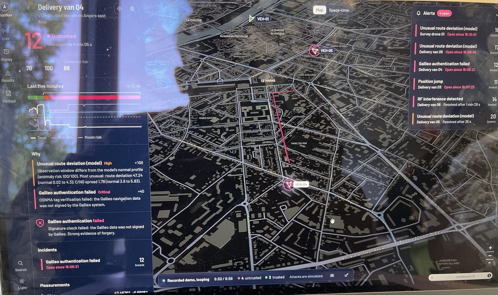

# TrustNav

**Live trust monitoring for GNSS positions.** TrustNav tells a vehicle or drone fleet operator, once per second, whether each position can be trusted, and explains why when it cannot. It detects spoofing and jamming with three layers of evidence: physical rules, unsupervised anomaly models, and Galileo OSNMA authentication.

> Research prototype, MSc Cybersecurity & Data Science, ESAIP Angers (Group 2).
> All attacks are simulated in software. No radio signal is transmitted, jammed or spoofed.

**Live demo:** https://trustnav.vercel.app (press `?` for "How to read this screen", `P` for presentation mode)



## In plain words

- Every second, for each van and drone, TrustNav checks whether its satellite position can be believed and gives it a **score from 0 to 100**, with the reason in everyday language ("the receiver places the van 8.0 km from the road it is actually on").
- Three kinds of evidence are combined: **physical rules** (a van cannot move 8 km in a second), a **model** that has learned what normal driving looks like (it notices a van 12 m off its road), and **Galileo's own digital signatures** (forged data fails the check).
- Below 50 it **refuses the position** and tracks the vehicle by its odometer along its route, so dispatch, geofencing or flight control never act on a lie. On the recorded attacks the worst lie an ordinary screen would show is 8.0 km; what TrustNav hands on is never more than 29 m off.
- Why it is different: existing tools either sit inside one receiver and output a flag with no explanation, or monitor a fixed site. TrustNav gives a fleet operator a per-vehicle, per-second, explained score with a response. Sources in [docs/COMPARISON.md](docs/COMPARISON.md).

## Documentation

**Start here:** [docs/TrustNav_Project_Brief.pdf](docs/TrustNav_Project_Brief.pdf) (6 pages: what, how to read the console, results, what comes next, the team). The complete reference is [docs/TrustNav_Technical_Documentation.pdf](docs/TrustNav_Technical_Documentation.pdf) (30 pages, everything below in one file). Both are built from this folder with `python3 docs/build_pdf.py`.

**Paper:** [paper/trustnav.pdf](paper/trustnav.pdf) is the project written up as a six-page IEEE conference paper (IEEEtran, LaTeX source in [paper/](paper/)): abstract, related work with sources, a comparison table, system design with the formulas, vector figures drawn from the evaluation data, the results tables, limitations, ethics and references. A French version is at [paper/trustnav_fr.pdf](paper/trustnav_fr.pdf).

| Document | What it explains |
|---|---|
| [docs/SUMMARY.md](docs/SUMMARY.md) | One page: what, why, how, results, limits, next |
| [docs/OBJECTIVES.md](docs/OBJECTIVES.md) | The problem, what the tool does in real life, who uses it, results and limits |
| [docs/HOW_IT_WORKS.md](docs/HOW_IT_WORKS.md) | The full pipeline step by step, from receiver observation to response and dashboard |
| [docs/CODE_GUIDE.md](docs/CODE_GUIDE.md) | Every file and function, tests, security model, deployment, how to plug in a real receiver |
| [docs/COMPARISON.md](docs/COMPARISON.md) | How it differs from receiver flags, fixed probes, anti-jam hardware, fleet telematics, OSNMA and recent papers, with sources |
| [docs/ROADMAP.md](docs/ROADMAP.md) | Prevention versus detection, and the improvement plan: real receiver, calibration, recorded attacks, second antenna, OSNMA |
| [docs/ETHICS.md](docs/ETHICS.md) | Safety, legal and ethics: nothing transmitted, receive-only hardware, personal data, security of the system, honest claims |
| [docs/TEAM.md](docs/TEAM.md) | Who is responsible for what in Group 2 |

## What it does

```
Receiver observation (1 Hz)          position, speed, satellites, C/N0, PDOP, residuals,
        │                            clock, jamming indicator, Galileo OSNMA status, IMU speed
        ▼
Features (36)                        compared with the last 5 epochs and the assigned route
        │
   ┌────┴─────┐
   ▼          ▼
Rules (15)   Model                   Isolation Forest + per-feature tail detector,
   │          │                      trained on normal data only
   └────┬─────┘
        ▼
Noisy-OR fusion → trust 0–100 + evidence → incidents → live dashboard
        │
        ▼
Response layer                       below 50 the fix is refused; the position handed on is dead reckoned
                                     from the odometer along the route; action: continue, verify or isolate
```

## Results (held-out routes, synthetic data)

| | Rules only | Model only | **Hybrid** |
|---|---|---|---|
| Precision | 100% | 97.9% | **99.3%** |
| Recall | 27.9% | 90.1% | **96.1%** |
| F1 | 0.437 | 0.939 | **0.977** |
| False alarm rate | 0% | 1.33% | **0.44%** |

Ten held-out scenarios: two normal drives, teleport spoof, gradual drift, signal anomaly, stealth drift (OSNMA still verified), OSNMA forgery, jamming with recovery, and two drone survey missions. The stealth drift is caught about 40 s after it starts, at roughly 12 m off the road; the fixed 150 m rule alone would take about 3.5 minutes.

**Response layer** on the same attacks: the worst position an ordinary screen would show is 8.0 km off; what TrustNav hands downstream is never more than 29 m off. The 100 s jamming blank screen becomes 0 s. Holds outside attacks total 26 s over the whole catalogue.

These numbers are an upper bound: one simulator produces every split. See *Limitations* in the dashboard's Method tab.

## Repository layout

| Path | What |
|---|---|
| `engine/` | Python detection engine: simulator, features, rules, model, fusion, response layer, incidents, evaluation, live streamer, real-receiver adapter |
| `dashboard/` | Next.js control room: live fleet, replay, incidents, evaluation, method |
| `supabase/` | Database schema, row-level security, demo feed, ingest Edge Function |

## Run the engine

```bash
cd engine
python -m pip install -r requirements.txt
python -m pytest -q                      # 23 tests
python -m trustnav_engine.evaluate       # train, choose fusion weights, print held-out metrics
python -m trustnav_engine.export         # write out/*.json for the dashboard
python -m trustnav_engine.stream --dry-run --speed 10   # live engine without sending
python -m trustnav_engine.receiver --port /dev/ttyACM0 --no-model --dry-run   # a real u-blox receiver (NMEA/UBX over USB)
```

To stream live to the dashboard, put the ingest URL and token in `engine/.env.local` (never committed) and run:

```bash
set -a; source .env.local; set +a
python -m trustnav_engine.stream
```

## Run the dashboard

```bash
cd dashboard
npm install
npm run dev
```

**Space-time view** (toggle at the top of the map, in Live and Replay): the ground is the map in metres and height is time, so each platform's track rises as a ribbon coloured by trust. A spoof tears the ribbon away from the real path; drift is a lean; jamming is a gap. Drag to rotate, wheel to zoom. Pure canvas, no tiles.

Opening screen offers a narrated 60-second story of an attack (also `#replay?scenario=teleport_spoof&story=1`, or "Watch the attack" in the search). The map is tilted with 3D buildings; `T` opens the fleet timeline dock.

**Live console** (v6): a fleet KPI strip (fleet trust, platforms, open incidents, positions refused and the worst lie refused); markers with a trust ring and score; a refused fix drawn hollow with a shield at the protected position, the dashed lie between them and its length; alert cards with sparklines, the response action and an acknowledge button; an operator playbook (what to do now) for any platform on hold; and **presentation mode** (`P`), where the camera visits every platform, incidents first, with a caption, for a jury or a wall screen.

**Your phone as a live receiver** (v10): open [trustnav.vercel.app/phone](https://trustnav.vercel.app/phone) on any phone, paste the ingest token and tap *Start sending*: the phone's own GNSS fixes go to the cloud once a second, `python -m trustnav_engine.phone` on a laptop scores them with the same rules and response layer as every receiver, and the live console shows the phone moving over the real streets of Angers with a trust score. A switch on the phone page overlays a teleport, a slow drift or jamming on the real stream (in software, nothing is transmitted), so detection and the response can be shown on real data without buying hardware. A phone gives position, speed and heading but no per-satellite signal strength, clock or OSNMA, which is what the dual-band receiver board adds later.

**Opening screen in ten languages and voice everywhere** (v9): the opening screen has a language menu (shared with the explainer); the 60-second attack story and presentation mode read their captions aloud, with a mute button on the caption.

**Narrated explainer** (v8): "Explain it to me, with voice" on the opening screen (also in the `?` guide and the ⌘K search) plays a three-minute, video-style walkthrough inside the console: nine scenes that move the camera, highlight one panel at a time, show a caption and speak it, in **ten languages** (English, French, German, Spanish, Italian, Portuguese, Hindi, Marathi, Telugu, Tamil). The voice is the browser's own speech synthesis, so it works offline; when the device has no voice for a language, the captions are timed instead (Marathi borrows the Hindi voice). Space pauses, the arrow keys step, Esc leaves.

**Plain words** (v7): every platform panel opens with a verdict a non-expert understands ("Satellite signal is being faked: the receiver places the van 8.0 km from the road it is on; TrustNav is tracking it by its odometer"), derived from the evidence only, so it works on a real receiver. Evidence lines use everyday wording with the engineering term in brackets. `?` opens **How to read this screen**: the map legend, the panels, and the three things that go wrong, in one page.

Keyboard: `1`–`4` switch pages, `?` opens the guide, `⌘K` / `Ctrl K` opens the search, `J`/`K` step through platforms, `Esc` goes back, `F` follows the selected platform, `R` opens its incident report, `T` the fleet timeline, `P` presentation mode, `D` toggles dark mode, `Space` and the arrow keys drive the replay.

End-to-end checks (every view, interactions, shortcuts, dark mode, phone layout, axe accessibility scan, JS budget):

```bash
npm run build && npx next start -p 3100 &
python3 tests/e2e.py http://localhost:3100
```

The dashboard reads public, synthetic data only. Writes go through the ingest function (token, stored as a SHA-256 hash) or the presenter controls (passcode, stored as a bcrypt hash, rate-limited).

## Data sources

- Road geometry: OpenStreetMap contributors, routed with OSRM.
- Basemap: CARTO Dark Matter (OpenStreetMap data).
- Galileo OSNMA operational since 24 July 2025 (EUSPA).

## Roadmap

1. Real receiver: u-blox ZED-F9P with OSNMA firmware, Raspberry Pi, walk and tram tests in Angers.
2. Drone: PX4 simulator, then a real airframe.
3. Real attack data: Jammertest (Andøya, Norway) recordings.
