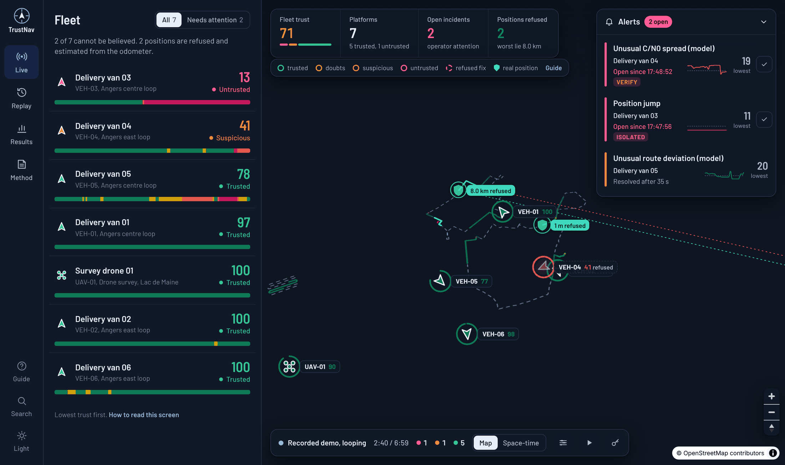

# TrustNav

**Live trust monitoring for GNSS positions.** TrustNav tells a vehicle or drone fleet operator, once per second, whether each position can be trusted, and explains why when it cannot. It detects spoofing and jamming with three layers of evidence: physical rules, unsupervised anomaly models, and Galileo OSNMA authentication.

> Research prototype, MSc Cybersecurity & Data Science, ESAIP Angers (Group 2).
> Our own attacks are simulated in software; real ones are replayed from public recordings made by others. No radio signal is transmitted, jammed or spoofed.

**Live demo:** https://trustnav.vercel.app (press `?` for "How to read this screen", `P` for presentation mode)



## In plain words

- Every second, for each van and drone, TrustNav checks whether its satellite position can be believed and gives it a **score from 0 to 100**, with the reason in everyday language ("the receiver places the van 8.0 km from the road it is actually on").
- Three kinds of evidence are combined: **physical rules** (a van cannot move 8 km in a second), a **model** that has learned what normal driving looks like (it notices a van 12 m off its road), and **Galileo's own digital signatures** (forged data fails the check).
- Below 50 it **refuses the position** and tracks the vehicle by its odometer along its route, so dispatch, geofencing or flight control never act on a lie. On the recorded attacks the worst lie an ordinary screen would show is 8.0 km; what TrustNav hands on is never more than 29 m off.
- It has been replayed on **recordings of real attacks** (Jammertest 2024, Norway). The first version missed a phone captured by a spoofer for 21 min 49 s; a sixteenth rule, receiver time checked against the clock of the device it is plugged into, now refuses every captured fix from the first second. Real jamming is alerted in 15 of 20 exposures.
- Why it is different: existing tools either sit inside one receiver and output a flag with no explanation, or monitor a fixed site. TrustNav gives a fleet operator a per-vehicle, per-second, explained score with a response. Sources in [docs/COMPARISON.md](docs/COMPARISON.md).

## Documentation

**Start here:** [docs/TrustNav_Project_Brief.pdf](docs/TrustNav_Project_Brief.pdf) (the project summary, 6 pages: what, how to read the console, results, what comes next, the team). The project report is [docs/TrustNav_Technical_Documentation.pdf](docs/TrustNav_Technical_Documentation.pdf) (44 pages, everything below in one file: abstract in English and French, contents with page numbers, the requirements, the approach and the choices, how it works, results, critical review, project management, three annexes). Both are built from this folder with `python3 docs/build_pdf.py`.

**Demonstration on paper:** [docs/TrustNav_Demo_Guide.pdf](docs/TrustNav_Demo_Guide.pdf) is the demonstration on two pages, for a reader who cannot attend it: the link, the four screens worth opening and what each one proves (built with `python3 docs/build_guide.py`).

**Oral examination:** [presentation/](presentation/) holds the ten-slide deck (PowerPoint and PDF), a speaker-notes booklet with the running order and likely questions, and the talk on one page.

**Paper:** [paper/trustnav.pdf](paper/trustnav.pdf) is the project written up as a six-page IEEE conference paper (IEEEtran, LaTeX source in [paper/](paper/)): abstract, related work with sources, a comparison table, threat model and attack taxonomy, system design with the formulas, vector figures drawn from the evaluation data, the results tables with a signal-only baseline and scenario-level confidence intervals, a sensitivity and calibration analysis, a replay on a real drive and on recordings of real attacks, limitations, ethics and references. Every quoted statistic is regenerated by `paper/figures/make_figures.py`, `trustnav_engine.realcheck` and `trustnav_engine.attackcheck`. The same paper in French is [paper/trustnav_fr.pdf](paper/trustnav_fr.pdf).

| Document | What it explains |
|---|---|
| [docs/SUMMARY.md](docs/SUMMARY.md) | One page: what, why, how, results, limits, next |
| [docs/OBJECTIVES.md](docs/OBJECTIVES.md) | The problem, what the tool does in real life, who uses it, results and limits |
| [docs/REQUIREMENTS.md](docs/REQUIREMENTS.md) | The requirements (cahier des charges): what the system must do, the constraints, the tutor's requests, each with how it is met and where the proof is |
| [docs/APPROACH.md](docs/APPROACH.md) | The approach: from the problem to the solution, the options considered for each decision and why we chose as we did |
| [docs/HOW_IT_WORKS.md](docs/HOW_IT_WORKS.md) | The full pipeline step by step, from receiver observation to response and dashboard |
| [docs/CODE_GUIDE.md](docs/CODE_GUIDE.md) | Every file and function, tests, security model, deployment, how to plug in a real receiver |
| [docs/COMPARISON.md](docs/COMPARISON.md) | How it differs from receiver flags, fixed probes, anti-jam hardware, fleet telematics, OSNMA and recent papers, with sources |
| [docs/CRITIQUE.md](docs/CRITIQUE.md) | Critical review: what holds, what does not yet, what we got wrong and corrected, what we would do differently |
| [docs/ROADMAP.md](docs/ROADMAP.md) | Prevention versus detection, and the improvement plan: real receiver, calibration, recorded attacks, second antenna, OSNMA |
| [docs/ETHICS.md](docs/ETHICS.md) | Safety, legal and ethics: nothing transmitted, receive-only hardware, personal data, security of the system, honest claims |
| [docs/PROJECT.md](docs/PROJECT.md) | Project management: organisation, timeline, tools, quality, risks |
| [docs/TEAM.md](docs/TEAM.md) | Who is responsible for what in Group 2 |
| [docs/GLOSSARY.md](docs/GLOSSARY.md) | The terms used, in one line each |

## What it does

```
Receiver observation (1 Hz)          position, speed, satellites, C/N0, PDOP, residuals,
        │                            clock, jamming indicator, Galileo OSNMA status, IMU speed
        ▼
Features (36)                        compared with the last 5 epochs and the assigned route
        │
   ┌────┴─────┐
   ▼          ▼
Rules (16)   Model                   Isolation Forest + per-feature tail detector,
   │          │                      trained on normal data only
   └────┬─────┘
        ▼
Noisy-OR fusion → trust 0–100 + evidence → incidents → live dashboard
        │
        ▼
Response layer                       below 50 the fix is refused; the position handed on is dead reckoned
                                     from the odometer along the route; action: continue, verify or isolate
```

## Results (held-out routes, synthetic data)

| | Rules only | Model only | **Hybrid** |
|---|---|---|---|
| Precision | 100% | 97.9% | **99.3%** |
| Recall | 27.9% | 90.1% | **96.1%** |
| F1 | 0.437 | 0.939 | **0.977** |
| False alarm rate | 0% | 1.33% | **0.44%** |

Ten held-out scenarios: two normal drives, teleport spoof, gradual drift, signal anomaly, stealth drift (OSNMA still verified), OSNMA forgery, jamming with recovery, and two drone survey missions. The stealth drift is caught about 40 s after it starts, at roughly 12 m off the road; the fixed 150 m rule alone would take about 3.5 minutes.

**Response layer** on the same attacks: the worst position an ordinary screen would show is 8.0 km off; what TrustNav hands downstream is never more than 29 m off. The 100 s jamming blank screen becomes 0 s. Holds outside attacks total 26 s over the whole catalogue.

These numbers are an upper bound: one simulator produces every split. See *Limitations* in the dashboard's Method tab.

**Real drive, no attack** (`python -m trustnav_engine.realcheck`): a public 27.6-minute recording of a u-blox ZED-F9K driving a loop in Mountain View (Google gps-measurement-tools, Apache-2.0), with a NovAtel SPAN reference track, replayed through the same adapter and detector. Rules alone: no false alarm in the whole drive (minimum trust 90). C/N0 + satellite-count baseline: 86 false-alarm seconds. Model trained on the simulator: alerts on 89 % of the seconds, so it must be re-calibrated on the receiver in use; re-calibrated on the first 19 minutes of the drive it raises no alert in the remaining 8.5 minutes, and software attacks overlaid on that segment (8 km teleport, 0.7 m/s drift, jamming) are caught after 0, 35 and 1 s with the protected estimate within 0.8, 24 and 0.8 m of the reference (the reference track is the route and its speed the odometer, so these are idealised). Two findings went back into the design: the tail detector now scores in log space so extreme values stay ordered, and a long clean streak no longer releases a hold while the fix is still kilometres from the estimate.

**Real attacks** (`python -m trustnav_engine.attackcheck`): the VAARA dataset (University of Vaasa) was recorded in a car at Jammertest 2024 on Andøya, Norway, where the authorities let jammers and spoofers transmit. The recordings are replayed unchanged through the same adapter and detector; the command downloads the six files it needs, checks their SHA-256 and keeps them out of the repository.

| Real spoofing: a phone captured for 26.5 min, ending 10.2 km from the truth | First alert | Captured fixes refused |
|---|---|---|
| The 15 rules as first published | after 21 min 49 s | 5 of 909 |
| The same, with the car's speed as odometer | after 21 min 49 s | 32 of 909 |
| The same, with the model re-calibrated on this phone | same second | 41 of 909 |
| **16 rules: receiver time checked against the phone's own clock** | **same second** | **909 of 909** |

Nothing in the spoofed stream was physically impossible; what the spoofer could not hide was time (it set the phone's clock back an hour). With the sixteenth rule there is no alert in the 37 clean minutes before the capture nor in the 9 minutes declared free of tests, and with the car's speed as odometer and its track as route the position handed on stays within 45 m (median 2.3 m; a best case). **Real jamming:** a u-blox receiver driven past parked jammers, 20 exposures: the rules alone alert on 1 (its NMEA stream carries no jamming indicator); the hybrid, re-calibrated on the 38 minutes recorded before the first test, alerts on 15, about 10 s in, marks all 20 as degraded, and raises 0.8 % false alerts on clean-signal seconds. Beside the spoofer, the same u-blox was not captured: it is shown as degraded for 99 % of 62 minutes and its position is kept. Limits: two days of one campaign; the time rule needs a host clock, or a spoofer that moves time backwards. The recordings also exposed four defects in the adapter and the response layer, all fixed and tested.

## Repository layout

| Path | What |
|---|---|
| `engine/` | Python detection engine: simulator, features, rules, model, fusion, response layer, incidents, evaluation, live streamer, real-receiver adapter |
| `dashboard/` | Next.js control room: live fleet, replay, incidents, evaluation, method |
| `supabase/` | Database schema, row-level security, demo feed, ingest Edge Function |

## Run the engine

```bash
cd engine
python -m pip install -r requirements.txt
python -m pytest -q                      # 42 tests
python -m trustnav_engine.evaluate       # train, choose fusion weights, print held-out metrics
python -m trustnav_engine.export         # write out/*.json for the dashboard
python -m trustnav_engine.stream --dry-run --speed 10   # live engine without sending

# a real u-blox receiver (NMEA/UBX over USB)
python -m trustnav_engine.receiver --port /dev/ttyACM0 --no-model --dry-run

# replay the public real-receiver recording, re-calibrate, overlay attacks
python -m trustnav_engine.realcheck

# replay the public recordings of real jamming and spoofing (downloads about 50 MB once)
python -m trustnav_engine.attackcheck
```

To refresh the figures of the paper and the data of the site, add `--out ../paper/figures/realcheck.json ../dashboard/public/data/realcheck.json` to `realcheck`, and the same two paths with `attackcheck.json` to `attackcheck`.

To stream live to the dashboard, put the ingest URL and token in `engine/.env.local` (never committed) and run:

```bash
set -a; source .env.local; set +a
python -m trustnav_engine.stream
```

## Run the dashboard

```bash
cd dashboard
npm install
npm run dev
```

**Space-time view** (toggle at the top of the map, in Live and Replay): the ground is the map in metres and height is time, so each platform's track rises as a ribbon coloured by trust. A spoof tears the ribbon away from the real path; drift is a lean; jamming is a gap. Drag to rotate, wheel to zoom. Pure canvas, no tiles.

Opening screen offers a narrated 60-second story of an attack (also `#replay?scenario=teleport_spoof&story=1`, or "Watch the attack" in the search). The map is tilted with 3D buildings; `T` opens the fleet timeline dock.

**Read at a glance** (v13): the Results and Method pages are no longer long documents. Each is a board with five tabs, and every tab is one screen with one message: an overview ("Every attack caught, 6 of 7 within one second", three readings and three before-and-after doors), each attack with its trust strip and what the response prevented, the real attacks, the real drive, and the full tables for whoever wants to check; on the Method side the pipeline in one picture, the fusion lab, the sixteen rules drawn with their weights, the comparison with what exists, and the fine print. Explanations longer than a sentence sit behind "How this was measured". The panels of the live console and the replay say less: shorter verdicts, measurements folded away, labels in sentence case, and what the model found unusual is drawn, not written: each measure with its value on a small track whose middle third is its normal range. On a small laptop or a projector (1280 by 720, 1366 by 768) the instruments over the map make room for each other; the tests measure it. A tab is part of the address (`#results?tab=real-attacks`), so it can be linked.

**On recordings of real attacks** (v12): the Results page has a section that leaves the simulator: a phone captured by a real spoofer for 26.5 minutes (the reported error against the error handed on, the four detectors compared), a u-blox receiver under real jamming and beside the spoofer, and what the recordings changed in the engine. The earlier real-receiver section is now **On a real drive with no attack**. The Method page lists the sixteenth rule.

**Opening scene, scoreboard and fusion lab** (v11): the opening screen now plays the recorded teleport attack as a live scene (the van on its real Angers route, the reported position thrown 8 km away, the trust gauge falling from 95 to 12 and the protected position carrying on); the Results page opens with a scoreboard (precision, recall, false alarms, attacks caught, and bars comparing rules, model and combined); the Results page also has a section on a real receiver (the track of the public u-blox drive, false alarms before and after re-calibration, the three overlaid attacks); the Method page has a fusion lab where two sliders show what the noisy-OR fusion decides and what an average would have missed; and a link to the site now unfurls with a preview image of the opening scene.

**Your phone as a live receiver** (v10): open [trustnav.vercel.app/phone](https://trustnav.vercel.app/phone) on any phone, paste the ingest token and tap *Start sending*: the phone's own GNSS fixes go to the cloud once a second, `python -m trustnav_engine.phone` on a laptop scores them with the same rules and response layer as every receiver, and the live console shows the phone moving over the real streets of Angers with a trust score. A switch on the phone page overlays a teleport, a slow drift or jamming on the real stream (in software, nothing is transmitted), so detection and the response can be shown on real data without buying hardware. A phone gives position, speed and heading but no per-satellite signal strength, clock or OSNMA, which is what the dual-band receiver board adds later.

**Opening screen in ten languages and voice everywhere** (v9): the opening screen has a language menu (shared with the explainer); the 60-second attack story and presentation mode read their captions aloud, with a mute button on the caption.

**Narrated explainer** (v8): "Explain it to me, with voice" on the opening screen (also in the `?` guide and the ⌘K search) plays a three-minute, video-style walkthrough inside the console: nine scenes that move the camera, highlight one panel at a time, show a caption and speak it, in **ten languages** (English, French, German, Spanish, Italian, Portuguese, Hindi, Marathi, Telugu, Tamil). The voice is the browser's own speech synthesis, so it works offline; when the device has no voice for a language, the captions are timed instead (Marathi borrows the Hindi voice). Space pauses, the arrow keys step, Esc leaves.

**Plain words** (v7): every platform panel opens with a verdict a non-expert understands ("Satellite signal is being faked: the receiver places the van 8.0 km from the road it is on; TrustNav is tracking it by its odometer"), derived from the evidence only, so it works on a real receiver. Evidence lines use everyday wording with the engineering term in brackets. `?` opens **How to read this screen**: the map legend, the panels, and the three things that go wrong, in one page.

**Live console** (v6): a fleet KPI strip (fleet trust, platforms, open incidents, positions refused and the worst lie refused); markers with a trust ring and score; a refused fix drawn hollow with a shield at the protected position, the dashed lie between them and its length; alert cards with sparklines, the response action and an acknowledge button; an operator playbook (what to do now) for any platform on hold; and **presentation mode** (`P`), where the camera visits every platform, incidents first, with a caption, for a jury or a wall screen.

Keyboard: `1`–`4` switch pages, `?` opens the guide, `⌘K` / `Ctrl K` opens the search, `J`/`K` step through platforms, `Esc` goes back, `F` follows the selected platform, `R` opens its incident report, `T` the fleet timeline, `P` presentation mode, `D` toggles dark mode, `Space` and the arrow keys drive the replay.

End-to-end checks (every view, interactions, shortcuts, dark mode, phone layout, axe accessibility scan, JS budget):

```bash
npm run build && npx next start -p 3100 &
python3 tests/e2e.py http://localhost:3100
```

The dashboard reads public, synthetic data only. Writes go through the ingest function (token, stored as a SHA-256 hash) or the presenter controls (passcode, stored as a bcrypt hash, rate-limited).

## Data sources

- Road geometry: OpenStreetMap contributors, routed with OSRM.
- Basemap: CARTO Dark Matter (OpenStreetMap data).
- Galileo OSNMA operational since 24 July 2025 (EUSPA).
- Real drive: Google gps-measurement-tools example recordings (Apache-2.0); a copy of the two files used is in `engine/trustnav_engine/data/real/`.
- Real attacks: VAARA, University of Vaasa, Jammertest 2024 (github.com/UniVaasaDigiEco/VAARA). The repository states no licence, so its files are never copied here: `attackcheck` downloads them on demand.

## Roadmap

1. Real receiver: u-blox ZED-F9P with OSNMA firmware, Raspberry Pi, walk and tram tests in Angers.
2. Drone: PX4 simulator, then a real airframe.
3. Raw radio recordings of real attacks (Jammertest 2023, TEXBAT) through a software receiver. The receiver-level recordings of Jammertest 2024 are already replayed, see *Real attacks* above.
